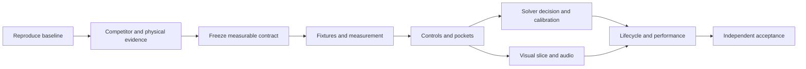

# How to use this package

Read ASSESSMENT.md for the diagnosis, RESEARCH.md for experiments and targets, then TASK.md for execution. QUESTIONS.md names unresolved decisions.

Verified-now source map: input -> strike -> simulation -> state/events -> render/audio -> save. Historical measurements are explicitly labeled in ASSESSMENT.md.

| Tempting approach | Why not select it yet |
|---|---|
| Increase tick rate | Cannot repair missing shelf support or poor power mapping |
| Replace all physics with native code | Parity, packaging and actual benefit remain unproven |
| Add more visual detail everywhere | Geometry/readability must pass before decoration |
| Add match features first | Does not address the owner's core quality rejection |

## Second exploration: a higher bar

Start with EXCELLENCE_EXPLORATION.md for detailed mechanisms and quality dimensions. EXCELLENCE_GATES.md adds research prompts and gates to the existing TASK.md. The first assessment remains the correctness floor.
